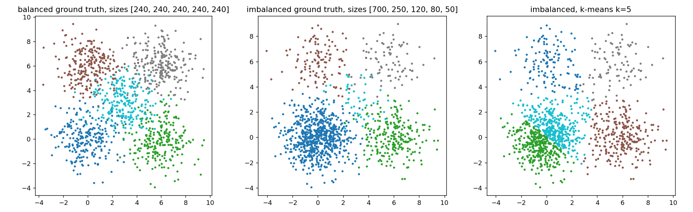
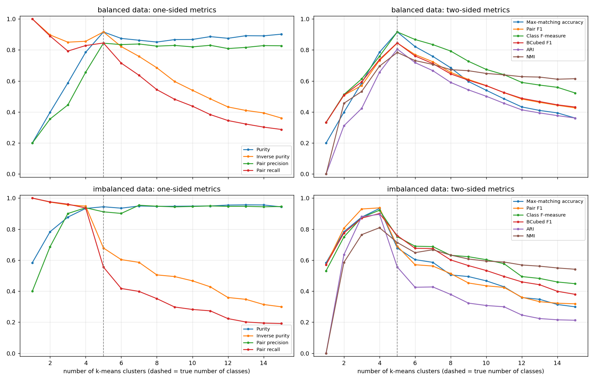
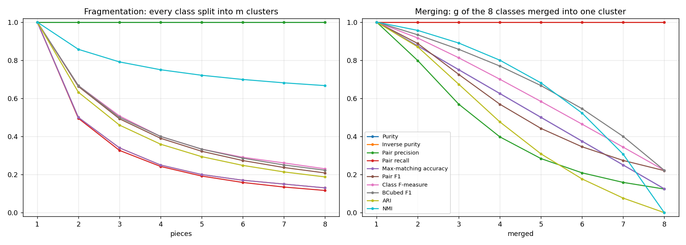
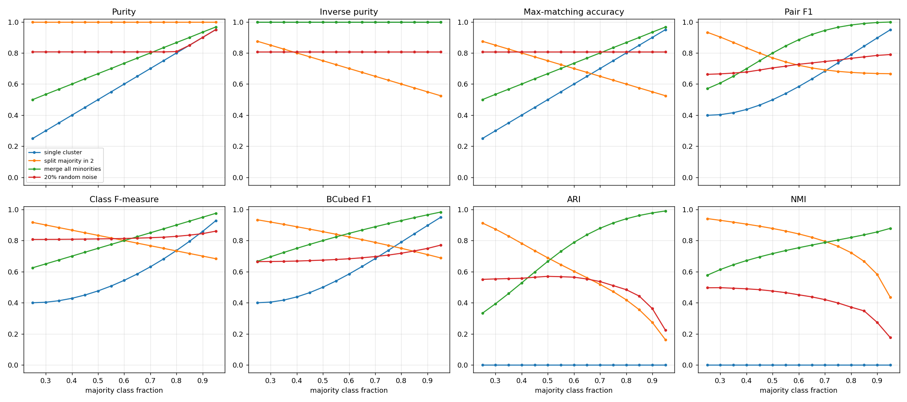
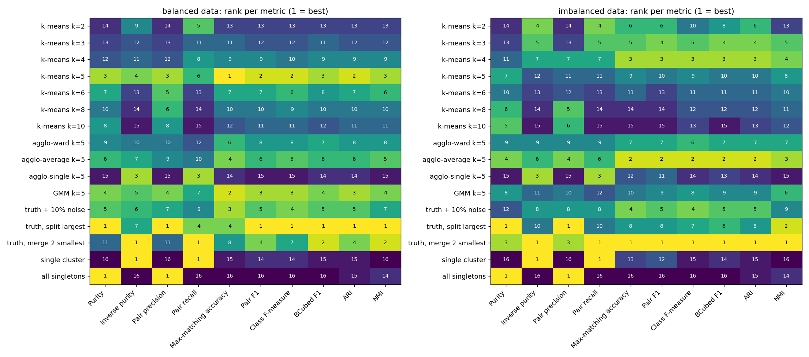
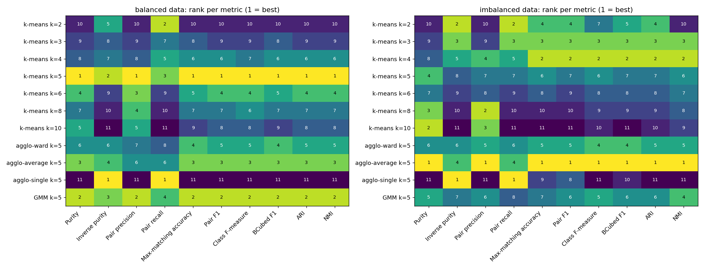
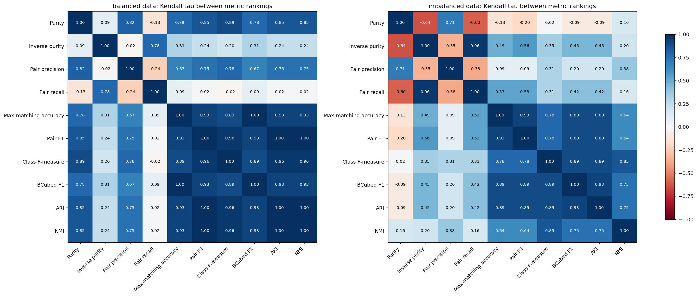

# When clustering metrics disagree

Research question: **how can evaluation metrics produce conflicting conclusions about
clustering quality?**

## Abstract

External clustering metrics compress the contingency matrix between predicted clusters and
true classes into a single number, and each compression encodes a different notion of
error. We implement purity, inverse purity, maximum-matching accuracy, pair-counting
precision, recall and F1, the class F-measure, BCubed, ARI and NMI from one contingency
matrix. We then evaluate them under controlled fragmentation and merging, a class-imbalance
sweep, k-means with k = 1…15, and a ranking of 16 candidate solutions on balanced and
imbalanced data.

One-sided metrics are maximised by degenerate clusterings. Pair recall and inverse purity
peak at k = 1. Purity and pair precision plateau near 0.95 for every k ≥ 4 and
reach 1.0 only on refinements of the truth, such as putting every point in its own cluster.
Metrics without chance correction prefer a single all-inclusive cluster over a solution
with one fragmentation error once the majority class is large enough: above exactly
p = 2/3 for accuracy, and somewhere in (0.75, 0.80] for BCubed F1. ARI,
which is chance-corrected, never does. NMI never does either, but only because a single
cluster carries zero mutual information. NMI is not chance-corrected: it gives "all
singletons" 0.286 where ARI gives 0. Among 11 solutions produced by clustering algorithms, the mean Kendall rank
correlation between six two-sided metrics drops from 0.95 on balanced data
to 0.83 on imbalanced data.

Conflicts arise from four design choices hidden inside each metric: which error type it
penalises, whether it counts points or pairs, how it matches clusters to classes, and
whether it corrects for chance. Class imbalance and a wrong number of clusters amplify all
four.

## Introduction and method

Clustering is unsupervised, so when ground-truth labels exist the natural evaluation is to
compare the predicted partition with the true one. Cluster identifiers are arbitrary,
however, so every external metric first builds the **contingency matrix** (true classes ×
predicted clusters) and then summarises it. The research question is how the choice of
summary can change the verdict.

Two failure modes are central:

- **Fragmentation:** a single true class is split across several clusters.
- **Merging:** several true classes share one cluster.

**Class imbalance** matters because it changes how much each class contributes to a
point-weighted or pair-weighted score.

**Data.** The data are two-dimensional Gaussian blobs with 5 classes around fixed centres
(standard deviation 1.3, so neighbouring classes overlap). The balanced version
has 5 × 240 points; the imbalanced one has class sizes [700, 250, 120, 80, 50]. The
controlled experiments use synthetic label vectors so that the type and size of every
error is known exactly.

**Clusterings.** k-means (k = 1…15), agglomerative clustering (ward, average and single
linkage), a Gaussian mixture model, and constructed corruptions of the truth (fragmenting a
class, merging classes, random label noise, one cluster, all singletons).

**Comparison of rankings.** For each metric, the solutions are ranked from best to worst.
Agreement between two metrics is measured by Kendall's tau over solution scores and by
the *disagreement rate*: the fraction of solution pairs, among those not tied under
either metric, that the two metrics order in opposite directions.

The implementation is verified by unit tests against textbook values and scikit-learn.

## 1. Metrics, all derived from the contingency matrix

Let `n_ij` be the number of points of true class *i* in predicted cluster *j*, `a_i` the
class sizes, `b_j` the cluster sizes and `N` the number of points.

| Metric | Definition | Error it ignores |
|---|---|---|
| Purity | Σ_j max_i n_ij / N | fragmentation (all singletons = 1) |
| Inverse purity | Σ_i max_j n_ij / N | merging (one cluster = 1) |
| Max-matching accuracy | best one-to-one class↔cluster assignment (Hungarian), matched points / N | none, but surplus clusters count fully as errors |
| Pair precision | pairs together in both / pairs together in prediction | fragmentation |
| Pair recall | pairs together in both / pairs together in truth | merging |
| Pair F1 | harmonic mean of pair precision and recall | weights classes by size² |
| Class F-measure | Σ_i (a_i/N) max_j F(i, j) (Larsen & Aone) | one cluster may serve several classes |
| BCubed F1 | per-point precision / recall, then F1 | — |
| ARI | Rand index corrected for chance | — |
| NMI | mutual information / mean entropy | not chance-corrected: lenient towards over-splitting (all singletons > 0); AMI is the corrected form |

### Worked contingency matrix (imbalanced data, k-means with k = 8)

|  | cluster 0 | cluster 1 | cluster 2 | cluster 3 | cluster 4 | cluster 5 | cluster 6 | cluster 7 | class size |
|---|---|---|---|---|---|---|---|---|---|
| class 0 | 0 | 194 | 251 | 0 | 237 | 1 | 8 | 9 | 700 |
| class 1 | 130 | 0 | 2 | 0 | 0 | 0 | 99 | 19 | 250 |
| class 2 | 0 | 1 | 0 | 1 | 0 | 110 | 0 | 8 | 120 |
| class 3 | 0 | 0 | 0 | 75 | 0 | 0 | 0 | 5 | 80 |
| class 4 | 1 | 2 | 3 | 1 | 0 | 3 | 0 | 40 | 50 |
| cluster size | 131 | 197 | 256 | 77 | 237 | 114 | 107 | 81 | 1200 |
| majority class | 1 | 0 | 0 | 3 | 0 | 2 | 1 | 4 |  |

Purity credits each cluster with its majority class, so it is
0.947. Max-matching accuracy may use each class only once, so
the three surplus clusters count as errors and accuracy drops to 0.505. The
Hungarian mapping (cluster → class) is `{2: 0, 0: 1, 5: 2, 3: 3, 7: 4}`.

## 2. Experiment 1: varying the number of clusters

K-means with k = 1…15 on 5-class blobs (balanced: 5 × 240 points; imbalanced:
[700, 250, 120, 80, 50]).

| Metric | best k (balanced) | best k (imbalanced) |
|---|---|---|
| Purity | 5 | 13 |
| Inverse purity | 1 | 1 |
| Pair precision | 5 | 7 |
| Pair recall | 1 | 1 |
| Max-matching accuracy | 5 | 4 |
| Pair F1 | 5 | 4 |
| Class F-measure | 5 | 4 |
| BCubed F1 | 5 | 4 |
| ARI | 5 | 4 |
| NMI | 5 | 4 |

The one-sided metrics are pulled towards the extremes. Inverse purity and pair recall are
maximised by a single cluster (k = 1). Purity and pair precision move the other way, but
on the imbalanced data they flatten out quickly. For every k ≥ 4, purity stays
between 0.933 and 0.957 and pair precision between 0.901 and
0.954. Their nominal best k values in the table, k =
13 and k =
7, are not meaningful peaks within that
plateau. Neither metric penalises extra clusters, and both reach 1.0 only on refinements of
the truth such as all singletons.

On the imbalanced data, every two-sided metric prefers
k = 4 to the true k = 5. The contingency
matrices show why. At k = 5, k-means spends a centroid splitting the 700-point class
in half, and the 50-point central class still gets no cluster of its own:

|  | cluster 0 | cluster 1 | cluster 2 | cluster 3 | cluster 4 |
|---|---|---|---|---|---|
| class 0 | 2 | 353 | 6 | 0 | 339 |
| class 1 | 0 | 0 | 245 | 1 | 4 |
| class 2 | 117 | 0 | 0 | 1 | 2 |
| class 3 | 1 | 0 | 0 | 79 | 0 |
| class 4 | 11 | 0 | 10 | 9 | 20 |

At k = 4, the majority class stays intact and only the tiny class is lost:

|  | cluster 0 | cluster 1 | cluster 2 | cluster 3 |
|---|---|---|---|---|
| class 0 | 12 | 676 | 12 | 0 |
| class 1 | 0 | 2 | 247 | 1 |
| class 2 | 119 | 0 | 0 | 1 |
| class 3 | 2 | 0 | 0 | 78 |
| class 4 | 17 | 6 | 18 | 9 |

Purity barely notices the split (0.944 at k = 5 vs
0.933 at k = 4). Max-matching accuracy collapses
from 0.933 to 0.678 because one
half of the majority class can no longer be matched. This is the same data and the same
pair of clusterings, but purity and accuracy reach opposite conclusions.

## 3. Experiment 2: fragmentation vs merging

Ground truth of 8 classes × 100 points; either split every class into *m* clusters or
merge *g* classes into one.

| pieces | Purity | Inverse purity | Pair precision | Pair recall | Max-matching accuracy | Pair F1 | Class F-measure | BCubed F1 | ARI | NMI |
|---|---|---|---|---|---|---|---|---|---|---|
| 1 | 1.000 | 1.000 | 1.000 | 1.000 | 1.000 | 1.000 | 1.000 | 1.000 | 1.000 | 1.000 |
| 2 | 1.000 | 0.500 | 1.000 | 0.495 | 0.500 | 0.662 | 0.667 | 0.667 | 0.632 | 0.857 |
| 3 | 1.000 | 0.340 | 1.000 | 0.327 | 0.340 | 0.492 | 0.507 | 0.500 | 0.459 | 0.791 |
| 4 | 1.000 | 0.250 | 1.000 | 0.242 | 0.250 | 0.390 | 0.400 | 0.400 | 0.359 | 0.750 |
| 5 | 1.000 | 0.200 | 1.000 | 0.192 | 0.200 | 0.322 | 0.333 | 0.333 | 0.294 | 0.721 |
| 6 | 1.000 | 0.170 | 1.000 | 0.158 | 0.170 | 0.273 | 0.291 | 0.286 | 0.248 | 0.699 |
| 7 | 1.000 | 0.150 | 1.000 | 0.134 | 0.150 | 0.237 | 0.261 | 0.250 | 0.214 | 0.681 |
| 8 | 1.000 | 0.130 | 1.000 | 0.116 | 0.130 | 0.208 | 0.230 | 0.223 | 0.187 | 0.667 |

*Fragmentation (rows = pieces per class).*

| merged | Purity | Inverse purity | Pair precision | Pair recall | Max-matching accuracy | Pair F1 | Class F-measure | BCubed F1 | ARI | NMI |
|---|---|---|---|---|---|---|---|---|---|---|
| 1 | 1.000 | 1.000 | 1.000 | 1.000 | 1.000 | 1.000 | 1.000 | 1.000 | 1.000 | 1.000 |
| 2 | 0.875 | 1.000 | 0.798 | 1.000 | 0.875 | 0.888 | 0.917 | 0.933 | 0.870 | 0.957 |
| 3 | 0.750 | 1.000 | 0.569 | 1.000 | 0.750 | 0.725 | 0.812 | 0.857 | 0.674 | 0.890 |
| 4 | 0.625 | 1.000 | 0.398 | 1.000 | 0.625 | 0.569 | 0.700 | 0.769 | 0.476 | 0.800 |
| 5 | 0.500 | 1.000 | 0.284 | 1.000 | 0.500 | 0.442 | 0.583 | 0.667 | 0.308 | 0.681 |
| 6 | 0.375 | 1.000 | 0.209 | 1.000 | 0.375 | 0.346 | 0.464 | 0.545 | 0.177 | 0.523 |
| 7 | 0.250 | 1.000 | 0.159 | 1.000 | 0.250 | 0.274 | 0.344 | 0.400 | 0.076 | 0.307 |
| 8 | 0.125 | 1.000 | 0.124 | 1.000 | 0.125 | 0.220 | 0.222 | 0.222 | 0.000 | 0.000 |

*Merging (rows = number of classes merged).*

Fragmentation is invisible to purity, pair precision and BCubed precision, all of which
stay at 1.0. Merging is invisible to inverse purity, pair recall and BCubed recall. So any
single one-sided score can rank a badly fragmented solution above a mildly merged one, or
the reverse.

### One split vs one merge

| Scenario | Purity | Inverse purity | Pair precision | Pair recall | Max-matching accuracy | Pair F1 | Class F-measure | BCubed F1 | ARI | NMI |
|---|---|---|---|---|---|---|---|---|---|---|
| balanced: split one class in 2 | 1.000 | 0.875 | 1.000 | 0.874 | 0.875 | 0.933 | 0.917 | 0.933 | 0.913 | 0.941 |
| balanced: merge two classes | 0.750 | 1.000 | 0.666 | 1.000 | 0.750 | 0.799 | 0.833 | 0.857 | 0.714 | 0.857 |
| imbalanced: split majority in 2 | 1.000 | 0.650 | 1.000 | 0.532 | 0.650 | 0.695 | 0.767 | 0.788 | 0.520 | 0.790 |
| imbalanced: merge two smallest | 0.950 | 1.000 | 0.981 | 1.000 | 0.950 | 0.991 | 0.955 | 0.966 | 0.980 | 0.945 |
| imbalanced: merge majority + smallest | 0.950 | 1.000 | 0.882 | 1.000 | 0.950 | 0.937 | 0.932 | 0.951 | 0.859 | 0.888 |

*Separate synthetic labellings, distinct from the blob data and from Experiment 3. Balanced
rows: 4 classes × 250 points. Imbalanced
rows: class sizes [700, 150, 100, 50] (1000 points).*

The same structural mistake costs very different amounts depending on which class it
hits. On imbalanced data, splitting the majority class in half costs pair F1 a lot because
it destroys a quadratic number of pairs. NMI, by contrast, stays relatively high
(0.790 against an ARI of
0.520). Merging the two smallest classes
barely registers under pair-based metrics (pair F1
0.991), but max-matching accuracy
charges for every point of the unmatched class
(0.950).

## 4. Experiment 3: class imbalance

Four classes and 1000 points; the majority class holds a fraction *p*, and the rest is
split evenly over three minority classes.

**When does a degenerate one-cluster answer beat a solution with one fragmentation error
(perfect except that the majority class is split in two)?**

| Metric | crossover p lies in (sweep step 0.05) | exact crossover |
|---|---|---|
| Purity | never | – |
| Inverse purity | always | – |
| Max-matching accuracy | (0.65, 0.70] | p = 2/3 (single cluster scores p, split scores 1 − p/2) |
| Pair F1 | (0.70, 0.75] | – |
| Class F-measure | (0.75, 0.80] | – |
| BCubed F1 | (0.75, 0.80] | – |
| ARI | never | – |
| NMI | never | – |

The sweep moves *p* in steps of 0.05, so each crossover is only known to lie within one
step. Accuracy has a closed form: the single cluster scores *p* and the split scores
1 − *p*/2, so they cross at exactly *p* = 2/3.

**Best solution per metric as imbalance grows:**

| Metric | p = 0.25 | p = 0.50 | p = 0.75 | p = 0.95 |
|---|---|---|---|---|
| Purity | split majority in 2 | split majority in 2 | split majority in 2 | split majority in 2 |
| Inverse purity | single cluster / merge all minorities | single cluster / merge all minorities | single cluster / merge all minorities | single cluster / merge all minorities |
| Max-matching accuracy | split majority in 2 | 20% random noise | merge all minorities | merge all minorities |
| Pair F1 | split majority in 2 | merge all minorities | merge all minorities | merge all minorities |
| Class F-measure | split majority in 2 | split majority in 2 | merge all minorities | merge all minorities |
| BCubed F1 | split majority in 2 | split majority in 2 | merge all minorities | merge all minorities |
| ARI | split majority in 2 | split majority in 2 | merge all minorities | merge all minorities |
| NMI | split majority in 2 | split majority in 2 | merge all minorities | merge all minorities |

The p = 0.50 row looks surprising: accuracy prefers 20% random noise
(0.807) to both structural errors (split majority
0.750, merge minorities 0.667). Random
noise costs about 20% of the points whatever the class sizes. Splitting the majority costs
*p*/2 of the points, and merging the three minorities costs 2(1 − *p*)/3. Noise therefore
wins under accuracy whenever both structural errors cost more than 20%, which in this sweep
happens for p = 0.40, 0.45, 0.50, 0.55, 0.60, 0.65, 0.70.

At p = 0.95 the single cluster scores purity 0.950,
accuracy 0.950 and pair F1
0.949, but ARI 0.000
and NMI 0.000. The two zeros have different causes. ARI is
chance-corrected, so any labelling that is no better than random scores 0. NMI is not
chance-corrected: it is 0 here only because a single cluster shares no information with
the classes, and it still rewards over-splitting (all singletons score
0.286 on the imbalanced blobs). Metrics without chance correction inherit
the majority-class baseline, so their absolute values become hard to interpret under
imbalance, and their rankings can flip in favour of trivial solutions.

## 5. Experiment 4: do metrics rank the same solutions the same way?

Each dataset gets 16 candidate solutions. 11 are produced by algorithms: k-means for
several k, agglomerative clustering (ward, average and single linkage) and a GMM. The other
5 are controlled corruptions of the truth (10% noise, split largest class, merge two
smallest classes) plus the two degenerate answers (one cluster, all singletons). Rankings
are analysed for the full pool and for the 11 algorithmic solutions alone, which is
the realistic model-selection setting.

### Full pool (16 solutions)

One controlled corruption, *truth, merge 2 smallest*, is closer to the truth than any algorithm output, and every two-sided metric ranks it first. The other corruptions do not dominate: *truth + 10% noise*, for example, loses to the best algorithms on every two-sided metric.

| Metric | Top-ranked solution(s) |
|---|---|
| Purity | truth, split largest, all singletons |
| Inverse purity | truth, merge 2 smallest, single cluster |
| Pair precision | truth, split largest, all singletons |
| Pair recall | truth, merge 2 smallest, single cluster |
| Max-matching accuracy | truth, merge 2 smallest |
| Pair F1 | truth, merge 2 smallest |
| Class F-measure | truth, merge 2 smallest |
| BCubed F1 | truth, merge 2 smallest |
| ARI | truth, merge 2 smallest |
| NMI | truth, merge 2 smallest |

*(imbalanced data; ties share rank 1)*

Even here, the one-sided metrics crown a degenerate answer. Purity and pair precision
give their maximum of 1.0 to "all singletons" as well as to the fragmented truth, while
inverse purity and pair recall give theirs to "single cluster" as well as to the merged
truth.

### Algorithmic solutions only (11 solutions)

| Statistic | balanced / all | imbalanced / all | balanced / algorithms | imbalanced / algorithms |
|---|---|---|---|---|
| mean Kendall tau (all 10 metrics) | 0.520 | 0.432 | 0.593 | 0.398 |
| min Kendall tau (all 10 metrics) | -0.286 | -0.504 | -0.236 | -0.636 |
| mean disagreement rate (all 10 metrics) | 0.239 | 0.284 | 0.204 | 0.301 |
| mean Kendall tau (6 two-sided metrics) | 0.877 | 0.817 | 0.949 | 0.825 |
| min Kendall tau (6 two-sided metrics) | 0.745 | 0.600 | 0.891 | 0.636 |
| mean disagreement rate (6 two-sided metrics) | 0.060 | 0.091 | 0.025 | 0.087 |
| mean rank spread across two-sided metrics | 2.000 | 2.938 | 0.545 | 1.818 |

*"Rank spread" is the average, over solutions, of (worst rank − best rank) that the six
two-sided metrics give the same solution.*

On the imbalanced data, the best algorithm according to the two-sided metrics is
*agglo-average k=5* by Max-matching accuracy, Pair F1, Class F-measure, BCubed F1, ARI, NMI. They do not agree on the worst one: *k-means k=10* by Max-matching accuracy, Pair F1, BCubed F1; *agglo-single k=5* by Class F-measure, ARI, NMI. The disagreements are not
limited to near-ties either. The widest gap among the two-sided metrics is for
*k-means k=2*, which is ranked 4 of 11 by
Max-matching accuracy but 10 by NMI.
Including one-sided metrics widens it further: over-split k-means with k = 10 is
ranked 2 by purity and
11 by accuracy.

### Concrete reversals (imbalanced data, algorithmic solutions)

- **Max-matching accuracy vs NMI** reverse the order of 10 solution pairs, e.g.
  - Max-matching accuracy prefers *agglo-single k=5* (0.585 vs 0.467); NMI prefers *k-means k=10* (0.594 vs 0.012)
  - Max-matching accuracy prefers *k-means k=2* (0.783 vs 0.676); NMI prefers *GMM k=5* (0.720 vs 0.585)
  - Max-matching accuracy prefers *k-means k=2* (0.783 vs 0.678); NMI prefers *k-means k=5* (0.714 vs 0.585)
- **Pair F1 vs ARI** reverse the order of 3 solution pairs, e.g.
  - Pair F1 prefers *agglo-single k=5* (0.572 vs 0.435); ARI prefers *k-means k=10* (0.308 vs 0.006)
  - Pair F1 prefers *agglo-single k=5* (0.572 vs 0.513); ARI prefers *k-means k=8* (0.379 vs 0.006)
  - Pair F1 prefers *agglo-single k=5* (0.572 vs 0.570); ARI prefers *k-means k=6* (0.425 vs 0.006)
- **BCubed F1 vs Max-matching accuracy** reverse the order of 3 solution pairs, e.g.
  - BCubed F1 prefers *k-means k=8* (0.602 vs 0.574); Max-matching accuracy prefers *agglo-single k=5* (0.585 vs 0.505)
  - BCubed F1 prefers *GMM k=5* (0.762 vs 0.758); Max-matching accuracy prefers *k-means k=5* (0.678 vs 0.676)
  - BCubed F1 prefers *agglo-ward k=5* (0.788 vs 0.775); Max-matching accuracy prefers *k-means k=2* (0.783 vs 0.781)
- **Class F-measure vs ARI** reverse the order of 3 solution pairs, e.g.
  - Class F-measure prefers *agglo-ward k=5* (0.833 vs 0.749); ARI prefers *k-means k=2* (0.635 vs 0.624)
  - Class F-measure prefers *GMM k=5* (0.754 vs 0.749); ARI prefers *k-means k=2* (0.635 vs 0.560)
  - Class F-measure prefers *k-means k=5* (0.751 vs 0.749); ARI prefers *k-means k=2* (0.635 vs 0.556)

### Full scores (imbalanced data)

| Solution | Purity | Inverse purity | Pair precision | Pair recall | Max-matching accuracy | Pair F1 | Class F-measure | BCubed F1 | ARI | NMI |
|---|---|---|---|---|---|---|---|---|---|---|
| k-means k=2 | 0.783 | 0.974 | 0.687 | 0.976 | 0.783 | 0.806 | 0.749 | 0.775 | 0.635 | 0.585 |
| k-means k=3 | 0.877 | 0.957 | 0.901 | 0.961 | 0.877 | 0.930 | 0.875 | 0.871 | 0.881 | 0.764 |
| k-means k=4 | 0.933 | 0.948 | 0.938 | 0.936 | 0.933 | 0.937 | 0.922 | 0.901 | 0.895 | 0.809 |
| k-means k=5 | 0.944 | 0.678 | 0.912 | 0.555 | 0.678 | 0.690 | 0.751 | 0.758 | 0.556 | 0.714 |
| k-means k=6 | 0.935 | 0.603 | 0.901 | 0.417 | 0.603 | 0.570 | 0.690 | 0.676 | 0.425 | 0.648 |
| k-means k=8 | 0.947 | 0.505 | 0.948 | 0.352 | 0.505 | 0.513 | 0.632 | 0.602 | 0.379 | 0.633 |
| k-means k=10 | 0.948 | 0.467 | 0.946 | 0.282 | 0.467 | 0.435 | 0.603 | 0.533 | 0.308 | 0.594 |
| agglo-ward k=5 | 0.938 | 0.797 | 0.921 | 0.627 | 0.781 | 0.746 | 0.833 | 0.788 | 0.624 | 0.719 |
| agglo-average k=5 | 0.951 | 0.951 | 0.964 | 0.943 | 0.951 | 0.953 | 0.953 | 0.915 | 0.923 | 0.836 |
| agglo-single k=5 | 0.587 | 0.997 | 0.401 | 0.998 | 0.585 | 0.572 | 0.532 | 0.574 | 0.006 | 0.012 |
| GMM k=5 | 0.943 | 0.690 | 0.921 | 0.555 | 0.676 | 0.692 | 0.754 | 0.762 | 0.560 | 0.720 |
| truth + 10% noise | 0.906 | 0.906 | 0.928 | 0.826 | 0.906 | 0.874 | 0.910 | 0.833 | 0.798 | 0.686 |
| truth, split largest | 1.000 | 0.708 | 1.000 | 0.574 | 0.708 | 0.729 | 0.806 | 0.829 | 0.618 | 0.854 |
| truth, merge 2 smallest | 0.958 | 1.000 | 0.986 | 1.000 | 0.958 | 0.993 | 0.966 | 0.974 | 0.988 | 0.969 |
| single cluster | 0.583 | 1.000 | 0.399 | 1.000 | 0.583 | 0.571 | 0.532 | 0.571 | 0.000 | 0.000 |
| all singletons | 1.000 | 0.004 | 1.000 | 0.000 | 0.004 | 0.000 | 0.008 | 0.008 | 0.000 | 0.286 |

## 6. Answer: how metrics come to conflicting conclusions

1. **They measure different error types.** Purity, pair precision and BCubed precision
   penalise only merging, and their mirror images penalise only fragmentation. Any
   one-sided score can be maximised by a degenerate clustering (all singletons or a single
   cluster), so it orders solutions by their number of clusters as much as by their
   quality.
2. **They count different units.** Point-based metrics (purity, accuracy, BCubed) weight a
   class linearly by its size. Pair-based metrics (pair P/R/F, ARI) weight it
   quadratically. Errors inside the majority class therefore dominate pair metrics, and
   errors in small classes almost vanish from them.
3. **They match clusters to classes differently.** Purity lets several clusters claim the
   same class, the class F-measure lets several classes claim the same cluster, and
   max-matching accuracy allows only a one-to-one mapping. A fragmented solution is free
   under purity but pays in full under accuracy. For merges the outcome depends on the
   class sizes involved. Merging two equal classes is penalised less by the class
   F-measure (0.833) than by accuracy (0.750),
   because one cluster can be the best match for both classes. Merging the majority with
   the smallest class reverses this (class F 0.932, accuracy
   0.950): the small class loses almost all of its precision, while
   accuracy still credits every majority point.
4. **Only some of them correct for chance.** With a 95% majority class, putting everything
   in one cluster scores accuracy 0.950 and pair F1
   0.949, while ARI = 0.000. A solution with one
   fragmentation error (the majority split in two) scores accuracy
   0.525 and pair F1 0.667, but ARI
   0.162. Uncorrected metrics inherit the majority-class baseline, so they
   rank the useless answer higher once imbalance passes a metric-specific threshold:
   exactly p = 2/3 for accuracy, and somewhere in (0.70, 0.75] for pair F1
   (see Experiment 3). Of the metrics studied, only ARI is chance-corrected. NMI also gives
   the single cluster 0, but only because it shares no information with the classes; NMI
   still gives all singletons 0.286. The chance-corrected form of NMI is the
   adjusted mutual information, AMI (Vinh et al., 2010). On the moderately imbalanced blobs
   (58% majority) the comparison does not flip: the single cluster's accuracy of
   0.583 is still below 0.708.

**What amplifies them**

- **A wrong number of clusters.** One-sided metrics reward moving k in one direction:
  purity and pair precision plateau as k grows, while inverse purity and pair recall peak
  at k = 1. Two-sided metrics differ in how hard they punish a wrong k. NMI is lenient
  towards over-splitting and harsh on under-splitting: on the imbalanced data it ranks
  k-means with k = 2 at 10 of 11 (accuracy: rank
  4) and k-means with k = 10 at
  9 of 11 (accuracy: rank
  11). Accuracy charges every surplus cluster in full.
- **Class imbalance.** Among the algorithmic solutions, the mean Kendall tau between the
  six two-sided metrics falls from 0.95 on balanced data to
  0.83 on imbalanced data. A typical pair of these metrics orders
  3% of solution pairs oppositely on balanced data and
  9% on imbalanced data, and the average rank spread of a solution
  grows from 0.5 to 1.8 places.

**Practical consequence:** a single number cannot certify a clustering as better. Report
a complementary pair that exposes both error types, such as pair or BCubed precision and
recall, or purity and inverse purity. Add a chance-corrected score (ARI, or AMI rather than
NMI) and show the contingency matrix itself, which is the only view that records exactly
which classes were split or merged.

## References

- Amigó, E., Gonzalo, J., Artiles, J. & Verdejo, F. (2009). A comparison of extrinsic
  clustering evaluation metrics based on formal constraints. *Information Retrieval*,
  12(4), 461–486.
- Bagga, A. & Baldwin, B. (1998). Entity-based cross-document coreferencing using the
  vector space model. *Proc. COLING-ACL*, 79–85.
- Hubert, L. & Arabie, P. (1985). Comparing partitions. *Journal of Classification*, 2,
  193–218.
- Kuhn, H. W. (1955). The Hungarian method for the assignment problem. *Naval Research
  Logistics Quarterly*, 2, 83–97.
- Larsen, B. & Aone, C. (1999). Fast and effective text mining using linear-time document
  clustering. *Proc. ACM SIGKDD*, 16–22.
- Manning, C. D., Raghavan, P. & Schütze, H. (2008). *Introduction to Information
  Retrieval*, ch. 16. Cambridge University Press.
- Strehl, A. & Ghosh, J. (2002). Cluster ensembles — a knowledge reuse framework for
  combining multiple partitions. *Journal of Machine Learning Research*, 3, 583–617.
- Vinh, N. X., Epps, J. & Bailey, J. (2010). Information theoretic measures for clusterings
  comparison. *Journal of Machine Learning Research*, 11, 2837–2854.
